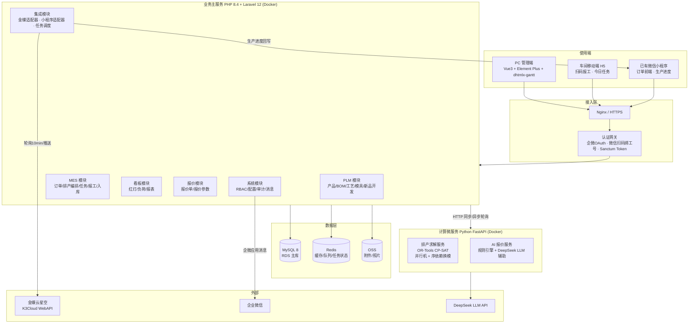
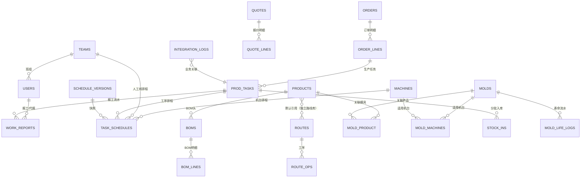

# 虹越智造平台 · 系统架构设计（v1.0）

> 依据：`PRD/虹越智造平台PRD-v1.0.html`（已冻结，20 项确认事项全部采纳）
> 定位：PLM + MES + AI 模拟报价 + 管理看板 一体化平台，替代黑湖小工单；金蝶云星空保留为生产核算 ERP
> 技术栈（客户锁定）：PHP 8.4 + Laravel 12 主栈 / Vue3 + Element Plus / Python FastAPI（OR-Tools + DeepSeek）/ MySQL 8 + Redis / 阿里云 ECS + Docker Compose
> 范围校准（2026-09-17）：订单生命周期终止于「已入库（produced）」；发货单、发货状态、库存防超发及小程序发货回写不属于本项目实现范围。

---

## 1. 总体架构



**关键决策说明**

| # | 决策 | 理由 |
|---|------|------|
| D1 | 排产编排在 Laravel（甘特数据/插单/当前排程锁定），求解在 Python | 甘特图与业务状态机在主栈事务内闭环；求解器是纯计算、无状态，HTTP 调用即可 |
| D2 | 排产请求异步化：Laravel 提交任务 → Python 返回 job_id → 前端轮询 `/ai/schedule/{job_id}` | 满足"100 任务 ≤30 秒"，避免 HTTP 长连接超时；结果落库为建议排程，人工确认后生效 |
| D3 | 报工台账只增不改：`work_reports` 仅 INSERT，更正用冲减负记录 | 二期计件工资审计、模具寿命折算、防篡改 |
| D4 | 分批入库可入库量 = 报工完成量 − 已入库量，入库单推送金蝶全异步（队列 + 重试 + 回执） | 金蝶不可用时现场报工/入库不阻塞（PRD T7） |
| D5 | 一期手工排产为主：甘特拖拽即保存排程明细（task_schedules），约束算法为"建议层"；页面只呈现当前唯一生效排程 | 手工排产是铁保底，算法结果由计划员接受或放弃；版本快照仅作内部安全留痕，不在页面提供版本切换/用户回滚 |
| D6 | 订单数据源：四期接金蝶生产订单轮询；一期/二期订单中心支持手工建单 + Excel 导入以先行跑通排产 | 排产（二期）不阻塞于金蝶联调进度 |
| D7 | 产品-模具-机台三匹配校验在排产保存前强制校验，不合格拒绝保存（强制排入需显式标记超期） | PRD §7.1.4/§7.2.3 |
| D8 | 红灯看板实时计算 + Redis 缓存（不建物化表），落后 >10% 自动生成"建议重排"提示 | 数据量小（20 机台/60 人），实时计算简单可靠 |
| D9 | 排产仅对外呈现当前唯一生效状态；`schedule_versions` 只保留内部 JSON 快照 | 用于审计和故障恢复，当前排产页面不展示版本列表、版本切换或用户回滚 |
| D10 | BOM/工艺/模具下发金蝶放在四期统一做（BOM 直发）；一期二期只做本地版本管理 | 工程自审直发无审批流（已确认 #19），先本地闭环、后集成 |

---

## 2. 模块划分

| 模块 | 职责 | 归属服务 |
|------|------|----------|
| **PLM 产品数据** | 产品档案、BOM（版本/发布状态）、工艺路线（工序/产能参数）、模具台账（寿命/保养/维修）、机台档案、新品开发流程（P1） | Laravel |
| **MES 订单与排产** | 订单中心（手工/Excel/金蝶拉取）、待排任务池、手工甘特排产、插单顺延、约束算法排产编排、当前排程锁定 | Laravel + Python |
| **MES 生产执行** | 生产任务、今日任务视图（H5）、极简报工（扫码/点选/代报/补报/冲减）、异常管理（P1）、模具寿命联动 | Laravel |
| **MES 仓储** | 分批入库（可入库量计算）、入库单推送金蝶、推送队列与重试 | Laravel |
| **报价中心** | 报价参数配置、AI 快速估价编排、报价单管理、历史数据沉淀 | Laravel + Python |
| **管理看板** | 订单进度总览、任务执行看板、产能负荷、红灯管理、报表中心 | Laravel |
| **系统管理** | RBAC、组织/车间/班组/班制、集成配置、操作审计、消息通知（企微/小程序） | Laravel |
| **集成** | 金蝶 K3Cloud WebAPI 适配（生产订单拉取/生产入库单推送/BOM 发布/物料同步）、小程序生产进度回写、集成日志、手动触发与对账 | Laravel |
| **AI 服务** | CP-SAT 排产求解、报价规则引擎、DeepSeek LLM 辅助（规格解析/报价说明/异常价校验） | Python |

---

## 3. 数据库核心表结构（字段级）

> 约定：主键均为 `id BIGINT UNSIGNED AUTO_INCREMENT`；`deleted_at` 采用软删除；`created_by / updated_by` 记录操作人；金额 DECIMAL(12,2)；时间 DATETIME；状态均含默认值。引擎 InnoDB，UTF8MB4。



### 3.1 组织与用户

**users**（用户/员工）
| 字段 | 类型 | 约束/索引 | 说明 |
|------|------|-----------|------|
| id | BIGINT PK | | |
| employee_no | VARCHAR(32) | UNIQUE | 工号（微信绑定时必填） |
| name | VARCHAR(64) | | 姓名 |
| phone | VARCHAR(20) | | |
| password_hash | VARCHAR(255) | NULL | 账号密码回退登录 |
| wecom_userid | VARCHAR(64) | UNIQUE, NULL | 企微免登 |
| wx_openid | VARCHAR(64) | UNIQUE, NULL | 小程序/微信扫码绑定 |
| team_id | BIGINT | IDX(team_id), FK→teams | 所属班组（可空=管理岗） |
| job_type | VARCHAR(32) | | worker/leader/planner/engineer/sales/admin/boss |
| status | TINYINT | IDX(status) | 1启用 0停用 |
| timestamps | | | |

**roles / permissions / model_has_roles / role_has_permissions**：采用 spatie/laravel-permission 标准四表，不做自定义。

**teams**（班组，含车间）
| 字段 | 类型 | 说明 |
|------|------|------|
| id / name | | 如：注塑车间一班 |
| workshop | VARCHAR(32) | 车间：注塑/吹塑/喷漆/效果/包装 |
| leader_user_id | BIGINT FK→users | 班组长 |
| shift_mode | VARCHAR(16) | 班制：`two_shift`（2班）/`day` |
| is_manual_line | TINYINT | 1=人工线（喷漆/效果/包装），0=机台线 |

**machines**（机台档案）
| 字段 | 类型 | 约束/索引 | 说明 |
|------|------|-----------|------|
| id | | | |
| code | VARCHAR(32) | UNIQUE | 如 I-01、B-02 |
| name | VARCHAR(64) | | |
| type | VARCHAR(16) | IDX(type) | `injection`注塑 / `blow`吹塑 / `paint_line`喷漆产线 / `effect_line`效果产线 / `pack_line`包装产线 |
| workshop | VARCHAR(32) | | 资源归属车间；喷漆、效果、包装产线分别对应 `paint`/`effect`/`pack` |
| capacity_per_hour | DECIMAL(10,2) | | 机台侧默认标准产能（件/小时），产品工艺为空时兜底 |
| mold_change_min | INT | | 机台侧默认换模分钟数 |
| tonnage | INT | NULL | 锁模力(吨)（APS一期）：吨位硬约束，需≥产品 required_tonnage；产线为 NULL |
| shift_mode | VARCHAR(16) | | 默认班制 |
| status | VARCHAR(16) | IDX(status) | running/stopped/maintenance |
| is_active | TINYINT | | |

> 机台/产线更新 capacity_per_hour、mold_change_min 或 shift_mode 后，系统在同一事务内按最新资源参数重算引用该资源的未完工工单工序链，并按机台/产线重新做资源避让；已完工或已有实际结束时间的工序不回改历史实际数据。预计时间仅在未发生现场滚动时跟随新计划更新。

**system_configs**（系统配置）
| 字段 | 说明 |
|------|------|
| config_key VARCHAR(64) UNIQUE | `shift.two_shift`班制时段、`k3.poll_interval_min`=10、`redlight.deviation_pct`=10、`schedule.over_report_pct`=100、`k3.*`连接配置（加密）等 |
| config_value JSON | |

### 3.2 PLM

**products**（产品档案）
| 字段 | 类型 | 约束/索引 | 说明 |
|------|------|-----------|------|
| id | | | |
| code | VARCHAR(64) | UNIQUE | 与金蝶物料编码一致（金蝶为主映射） |
| name | VARCHAR(128) | IDX(name) | |
| spec | VARCHAR(255) | | 规格 |
| unit | VARCHAR(16) | | |
| status | VARCHAR(16) | IDX(status) | developing/trial/mass/obsolete |
| default_mold_id | BIGINT | FK→molds, NULL | 默认模具 |
| default_route_id | BIGINT | FK→routes, NULL | 默认工艺路线 |
| weight | DECIMAL(10,3) | NULL | 单件重量(g)，报价材料估算用 |
| required_tonnage | INT | NULL | 所需最小锁模力(吨)（APS一期），排产吨位校验用 |

**boms**（BOM 头）
| 字段 | 说明 |
|------|------|
| product_id BIGINT FK→products, IDX(product_id) | |
| version VARCHAR(16) | UNIQUE(product_id, version) |
| status VARCHAR(16) | draft/published；IDX(status) |
| k3_push_status VARCHAR(16) | none/queued/pushed/failed（四期启用） |
| published_at DATETIME NULL、published_by BIGINT NULL | |
| remark | 变更说明 |

**bom_lines**（BOM 明细）

> 约定：明细行序 `seq` 为 BOM 内连续序号（1/2/3...，与工艺工序 seq、工序类型 sort 口径一致，不用 10 步进）。

| 字段 | 说明 |
|------|------|
| bom_id BIGINT FK→boms, IDX(bom_id) | |
| seq INT | 行序（连续 1/2/3，编辑时可手动调整） |
| item_code VARCHAR(64) | 材料编码（对齐金蝶物料） |
| item_name VARCHAR(128) | 材料名称 |
| qty DECIMAL(12,4) | 用量 |
| unit VARCHAR(16) | |
| loss_rate DECIMAL(5,2) | 损耗率 % |
| is_key TINYINT | 是否主材（报价材料成本取主材） |

**routes**（工艺路线头 —— 独立实体，不与产品绑定）：name（路线名称）、version、status(draft/published)、UNIQUE(name, version)。
产品仅通过 `products.default_route_id` 引用已发布路线；路线增删改与产品无关。

> 编辑生命周期（2026-08-31 业务确认，二次修订）：工艺路线与生产订单**完全脱离关联**。
> 订单/排程在第一次选择路线时把工序配置**快照**进 task_schedules（冗余 op_type/op_name/机台/产线/起止时间），
> 后续编辑路线（含名称/版本/说明/工序）不影响任何已生成排程数据；名称+版本唯一。

**route_ops**（工艺路线工序 —— 排产与报价共用的产能参数源）

> 约定：工序类型字典 `sort` 为连续序号（注塑 1 / 吹塑 2 / 喷漆 3 / 效果 4 / 包装 5）；
> 工艺路线工序 `seq` 为路线内连续序号（1/2/3/4）。两者各自独立、均从 1 开始连续。

| 字段 | 类型 | 约束/索引 | 说明 |
|------|------|-----------|------|
| id | | | |
| route_id | BIGINT | FK→routes, IDX(route_id) | |
| seq | INT | UNIQUE(route_id, seq) | 工序顺序 |
| op_type | VARCHAR(16) | IDX(op_type) | molding_injection/molding_blow/paint/effect/pack |
| op_name | VARCHAR(64) | | 工序名 |
| capacity_per_hour | DECIMAL(10,2) | NULL | 标准产能（件/小时），NULL=取机台/班组默认 |
| mold_change_min | INT | NULL | 换模分钟（成型工序）；当前排产计算统一按 30 分钟计入，并在生产+换模合计时长上增加 5% 预留 |
| shift_mode | VARCHAR(16) | NULL | NULL=取机台默认 |
| machine_type | VARCHAR(16) | NULL | 可用机台类型（成型工序） |
| team_id | BIGINT | FK→teams, NULL | 人工线班组（喷漆/效果/包装） |
| rate_key | VARCHAR(32) | NULL | 报价费率键（process_rates.rate_key） |

**molds**（模具台账）
| 字段 | 类型 | 约束/索引 | 说明 |
|------|------|-----------|------|
| id | | | |
| code | VARCHAR(32) | UNIQUE | |
| name | VARCHAR(128) | | |
| type | VARCHAR(16) | IDX(type) | injection/blow |
| status | VARCHAR(16) | IDX(status) | in_use/idle/repair/scrapped |
| location | VARCHAR(64) | | 存放位置 |
| cavity_count | INT | | 模穴数（寿命折算：开模次数=报工数÷模穴数） |
| lifetime_openings | INT | | 设计寿命（额定开模次数） |
| opened_count | INT | | 累计开模次数（由 work_report 事件累加） |
| purchase_cost | DECIMAL(12,2) | NULL | 模具造价（报价摊销用） |
| purchase_date / vendor | | | |
| maintain_cycle_days | INT | NULL | 保养周期 |
| last_maintain_at / next_maintain_at | DATETIME | NULL | 保养提醒 |
| notes | | | |

**mold_product**（模具-产品 多对多）：mold_id FK、product_id FK、is_default TINYINT、UNIQUE(mold_id, product_id)、IDX(product_id)。
**mold_machines**（模具-适用机台 多对多）：mold_id FK、machine_id FK、UNIQUE(mold_id, machine_id)、IDX(machine_id)。

**mold_change_matrices**（换模时间矩阵，APS一期）：按「前序模具→当前模具」记录换模耗时与禁止切换。
| 字段 | 说明 |
|------|------|
| from_mold_id / to_mold_id BIGINT FK→molds | UNIQUE(from_mold_id, to_mold_id) |
| changeover_minutes INT | 换模耗时（分钟） |
| is_forbidden TINYINT | 1=禁止切换（如黑料→白料需清机），排产保存直接拒绝（`changeover_forbidden`） |
| remark / created_by / updated_by / timestamps / soft_deletes | |
> 解析优先级（ChangeoverService）：矩阵记录 > route_ops.mold_change_min > machines.mold_change_min > 0；
> 模具-机台匹配仍走 mold_machines（三匹配事实源），本表只承载换模时间维度。
**mold_maintain_records**（保养/维修记录）：mold_id FK IDX、type(maintain/repair)、at DATETIME、cost、vendor、remark。

**mold_life_logs**（模具寿命流水）：mold_id FK IDX、task_id FK、work_report_id FK、opening_count INT、created_at。报工落库事件联动写入（=合格数÷模穴数）。

### 3.3 订单与排产

**orders**（订单头：来源小程序/手工/Excel）
| 字段 | 类型 | 约束/索引 | 说明 |
|------|------|-----------|------|
| id | | | |
| order_no | VARCHAR(32) | UNIQUE | 业务单号 |
| src | VARCHAR(16) | | mini_program/manual/excel/k3 |
| k3_bill_no | VARCHAR(32) | NULL | 金蝶生产订单号（四期拉单后落） |
| customer_name | VARCHAR(128) | | |
| status | VARCHAR(16) | IDX(status) | route_confirm(工艺确认)/pending(待排产)/scheduled(已排产)/in_progress(生产中)/paused(已停工)/produced(已入库)/aborted(已中止)/closed(已关闭) |
| priority | TINYINT | IDX(priority) | 0-5，数值越小越急，P0 最紧急 |

**order_lines**（订单明细：产品/数量/交期）
| 字段 | 说明 |
|------|------|
| order_id BIGINT FK IDX(order_id) | |
| product_id BIGINT FK IDX(product_id) | |
| qty INT | 数量 |
| delivery_date DATE | 交期 |
| priority TINYINT | |
| status VARCHAR(16) | pending/scheduled/in_progress/done |
| done_qty INT | 完成数（报工汇总冗余，可对账） |

**prod_tasks**（生产任务 —— 排产对象，产品级）
| 字段 | 类型 | 约束/索引 | 说明 |
|------|------|-----------|------|
| id | | | |
| parent_task_id | BIGINT | FK→prod_tasks.id, NULL | 拆单子任务指向原任务；父任务仅作为拆单容器 |
| task_no | VARCHAR(32) | UNIQUE | 任务号 |
| order_line_id | BIGINT | FK, IDX(order_line_id) | |
| product_id | BIGINT | FK, IDX(product_id) | |
| route_id | BIGINT | FK | 排产时锁定工艺版本 |
| mold_id | BIGINT | FK→molds, NULL | 选定模具（三匹配校验） |
| qty | INT | | 任务数量 |
| done_qty | INT | | 累计合格完成（=Σ报工合格数，可对账） |
| status | VARCHAR(16) | IDX(status) | unscheduled/scheduled/in_progress/paused/done/split |
| priority | TINYINT | | |
| delivery_date | DATE | IDX(delivery_date) | 交期（冗余自订单行，可单任务改） |
| deviation_pct | DECIMAL(5,2) | | 进度偏差%（实际完成 vs 计划），落后>10% 标红建议重排 |
| plan_start / plan_end | DATETIME | | 任务级计划起止（取第一/最后工序） |
| is_locked | TINYINT | | 排产锁定（保存即锁定；解锁留痕） |
| split_index / split_total | TINYINT | | 子任务序号/拆分总数 |
| is_split_parent | TINYINT | IDX | 1=拆单父任务，不进入任务池、排产、报工和入库汇总 |
| CONSTRAINT: qty > 0, done_qty BETWEEN 0 AND qty（可配置允许超 100%） | | | |

> 生产拆单只允许在任务未排产、未开工、无报工/入库记录时执行。原任务保留为父容器，数量不变；拆分后的子任务数量合计必须等于父任务数量。拆单阶段只拆分数量，不绑定模具或机台；子任务进入甘特图排产时再选择并校验产品-模具-机台匹配关系，从而支持“大单 + 多模具 + 多机台”并行生产。所有生产查询默认只读取叶子任务，避免父子重复统计。

**task_schedules**（工序排程明细 —— 甘特图数据源）
| 字段 | 类型 | 约束/索引 | 说明 |
|------|------|-----------|------|
| id | | | |
| task_id | BIGINT | FK, IDX(task_id) | |
| seq | INT | UNIQUE(task_id, seq) | 工序序 |
| route_op_id | BIGINT | NULL | 工艺路线工序（历史溯源，可悬空——排程为独立快照） |
| op_type | VARCHAR(16) | | 排程快照：冗余自 route_op |
| op_name | VARCHAR(64) | NULL | 排程快照：工序名（展示/顺延重算不依赖 route_ops） |
| machine_id | BIGINT | FK→machines, NULL | 机台（成型工序必填） |
| team_id | BIGINT | FK→teams, NULL | 班组（人工线工序必填） |
| mold_id | BIGINT | NULL | 成型工序模具（与 task.mold_id 一致） |
| plan_start / plan_end | DATETIME | IDX(machine_id, plan_start), IDX(team_id, plan_start) | 计划起止（自动按产能+班制+换模计算）；paused 时保留作甘特参考，不作为当前资源占用 |
| forecast_start / forecast_end | DATETIME | NULL | APS一期：预计起止（保存时=plan；报工驱动滚动，plan 永不自动改） |
| actual_start / actual_end | DATETIME | NULL | APS一期：实际起止（报工推断：首笔正报工/累计合格达工序量） |
| is_frozen | TINYINT | 0 | APS一期：冻结区标记（未来 N 天不可自动顺延，不限制手工重排） |
| changeover_minutes | INT | 0 | APS一期：排入时实际采用的换模分钟数（矩阵>工序>机台，留档） |
| qty INT | | | 该工序计划数量 |
| status | VARCHAR(16) | IDX(status) | pending/running/paused/done；paused 排程保留原计划展示，但释放机台/模具占用 |
| source | VARCHAR(16) | | manual/ai/insert/auto 变更来源 |
| CONSTRAINT: 成型工序 machine_id NOT NULL；人工线工序 team_id NOT NULL；plan_end > plan_start | | | |

**schedule_versions**（排产内部快照 —— 不作为当前页面版本功能）
| 字段 | 说明 |
|------|------|
| version_no INT | 自增版本 |
| type VARCHAR(16) | manual/ai/insert |
| status VARCHAR(16) | draft/applied/rolled_back |
| snapshot JSON | task_schedules 全量快照（before/after） |
| affected_orders JSON | 插单时受影响订单延期清单 |
| created_by / created_at / applied_at | |

**schedule_suggestions**（顺延建议，APS一期建议层）：报工滞后导致预计破交期/偏差超阈值时系统生成，计划员采纳/驳回——自动结果只是建议层，绝不自动改排程。
| 字段 | 说明 |
|------|------|
| type VARCHAR(16) | postpone=报工滞后顺延 |
| trigger_report_id BIGINT NULL | 触发报工流水 |
| task_id BIGINT NULL | 主受影响任务 |
| affected JSON | 受影响排程明细（schedule_id/seq/op_name/plan_end/forecast_end） |
| delayed_orders JSON | 延期订单清单（订单号/产品/交期/预计完成） |
| reason VARCHAR(255) | 生成原因（预计破交期/偏差超阈值） |
| status VARCHAR(16) IDX | pending/accepted/dismissed/expired（每任务至多一条 pending；正式排程变化后不再满足条件的建议自动失效） |
| processed_by / processed_at / created_by / timestamps | |
> 采纳：未完工工序 plan 对齐 forecast，并写入内部快照留痕；驳回：留痕不改排程；采纳后计划员仍可手动调整。当前页面不展示版本号，也不提供用户回滚。

### 3.4 生产执行

**work_reports**（报工流水 —— 只增不改）
| 字段 | 类型 | 约束/索引 | 说明 |
|------|------|-----------|------|
| id | | | |
| task_id | BIGINT | FK, IDX(task_id, report_time) | |
| schedule_id | BIGINT | FK→task_schedules, NULL | 报工对应工序（可空=任务级报） |
| product_id | BIGINT | FK | 冗余 |
| machine_id | BIGINT | FK, NULL | |
| qty | INT | | 合格数（冲减时为负） |
| defect_qty | INT | | 次品数（冲减时为负） |
| sign | TINYINT | | 1=正常 -1=冲减（更正原记录） |
| correction_of_report_id | BIGINT | FK→work_reports.id, NULL, IDX | 冲减对应的原正报工；历史冲减可为空 |
| report_by | BIGINT | FK→users, IDX(report_by) | 操作人 |
| worker_id | BIGINT | FK→users, IDX(worker_id) | **实际作业人（代报必选）** |
| report_time | DATETIME | IDX(report_time) | 报工时间 |
| start_time | DATETIME | IDX(schedule_id, start_time, end_time) | 本次实际作业开始时间；旧流水回填为 report_time |
| end_time | DATETIME | | 本次实际作业结束时间；必须不早于 start_time |
| work_date | DATE | IDX(work_date, shift_code, worker_id) | 实际作业日期（日结归属，不等于操作时间） |
| shift_code | VARCHAR(16) | | day/night，来自机台班制 |
| client_request_id | VARCHAR(64) | UNIQUE NULL | 移动端离线补传幂等键 |
| source | VARCHAR(16) | | scan/click/machine_qr/leader_batch/leader_report/makeup/offline |
| remark | VARCHAR(255) | | 冲减原因必填 |
| CONSTRAINT: qty+defect_qty ≠ 0；sign=-1 时 remark 非空；指定原报工时冲减不得超过该正报工剩余可冲减量 | | | |

> PC 当日报工接口 `/api/reports/daily-context` 的每行 `machine.shift_mode` 返回资源班制；白班资源只允许 `day`，两班制资源才允许选择 `day/night`。每行同时返回同一工单未打断排程的 `operation_options`，前端切换工序时同步切换 `schedule_id`、机台、计划时段和计划数量，提交报工仍由服务端校验工序链与资源匹配。

**stock_ins**（生产入库单 —— 分批入库）
| 字段 | 类型 | 约束/索引 | 说明 |
|------|------|-----------|------|
| id | | | |
| ins_no | VARCHAR(32) | UNIQUE | 入库单号 |
| task_id | BIGINT | FK, IDX(task_id) | |
| product_id | BIGINT | FK | |
| qty | INT | | 本次入库量 |
| ins_status | VARCHAR(16) | IDX(ins_status) | draft/confirmed/pushed |
| k3_push_status | VARCHAR(16) | IDX(k3_push_status) | queued/pushing/success/failed/retry |
| k3_bill_no | VARCHAR(32) | NULL | 金蝶生产入库单号 |
| k3_result JSON | | | 金蝶回执 |
| CONSTRAINT: qty ≤ (Σ该任务报工合格数 − Σ已入库量) —— 入库时服务端强校验 | | | |

### 3.5 报价

**quotes**（询价/报价单头）
| 字段 | 说明 |
|------|------|
| quote_no VARCHAR(32) UNIQUE | |
| customer_name VARCHAR(128) | |
| source VARCHAR(16) | sales/mini_program |
| status VARCHAR(16) | draft/sent/won/lost（草稿/已发/成交/未成交） |
| target_margin DECIMAL(5,2) | 目标毛利率 % |
| suggest_delivery DATE NULL | 建议交期 |
| final_price DECIMAL(12,2) NULL | 成交价 |
| created_by BIGINT FK | 业务员；audit 记录调价 |

**quote_lines**（报价明细行）
| 字段 | 说明 |
|------|------|
| quote_id BIGINT FK IDX | |
| spec_text VARCHAR(512) | 客户规格描述 |
| qty INT | 预估数量 |
| ref_product_id BIGINT FK NULL | 近似老品参照 |
| material_cost / process_cost / mold_amort / loss_cost DECIMAL(12,2) | 成本构成（可展开） |
| margin DECIMAL(5,2) | 毛利率 |
| suggest_price DECIMAL(12,2) | 建议单价 |
| delivery_days INT | 建议交期（天，联动产能负荷粗算） |
| llm_remark VARCHAR(512) | LLM 报价说明话术 |
| anomaly_flag TINYINT | 偏离历史成交 ±30% 提示 |

**material_prices**（材料价格）：material_code VARCHAR(64) IDX、material_name、price_per_unit DECIMAL(12,4)、unit、effective_date DATE、source VARCHAR(16)、UNIQUE(material_code, effective_date)。
**process_rates**（工序费率）：rate_key VARCHAR(32)、op_type、rate_type(machine/team)、rate DECIMAL(12,4) 元/小时、effective_date、UNIQUE(rate_key, effective_date)。
**quote_rules**（报价规则）：rule_key VARCHAR(32) UNIQUE（`loss_rate`行业损耗率、`mold_amort_rule`摊销规则、`min_margin`、`anomaly_deviation`=30）、rule_value DECIMAL、remark。

### 3.7 集成与审计

**integration_logs**（集成日志 —— 所有外部调用留痕）
| 字段 | 类型 | 约束/索引 | 说明 |
|------|------|-----------|------|
| id | | | |
| direction | VARCHAR(8) | | in=拉取 out=推送 |
| target | VARCHAR(16) | IDX(target) | k3/mini_program/ai |
| api_type | VARCHAR(32) | | pull_prod_order/push_stock_in/push_bom/sync_material/push_progress/ai_schedule/ai_quote |
| biz_type / biz_id | | IDX(biz_type, biz_id) | 业务关联（幂等键：api_type+biz_type+biz_id+成功状态唯一） |
| request_body / response_body | JSON | | 报文留痕（敏感字段脱敏） |
| status | VARCHAR(16) | IDX(status) | success/failed/retry |
| retry_count | TINYINT | | 默认最大 5 次 + 手动重试 |
| error_msg | VARCHAR(512) | | |
| created_at / finished_at | | | |

**audit_logs**（操作审计）：user_id、module、action（publish_bom/schedule_change/insert_order/quote_price_change/unlock_task…）、target_type、target_id、detail JSON、ip、created_at；IDX(user_id, created_at)、IDX(target_type, target_id)。

**notifications**（消息）：user_id FK IDX、channel(wecom/mini_program)、template、content、status、sent_at。

> **红灯看板**：不建物化表。`DashboardService::redLights()` 三源计算：① unscheduled 任务（prod_tasks.status=unscheduled）② 超时未报工（scheduled/in_progress 且计划开始已过 X 小时无报工记录）③ 逾期（plan_end < now 且 status≠done 或 delivery_date < today 且未完成）④ 落后>10%（deviation_pct>10）→ Redis 缓存 10s。

---

## 4. 内部 API 清单（Laravel 主服务，REST 概览）

> 统一前缀 `/api`，Sanctum Bearer Token 认证；统一响应 `{code, message, data}`；分页 `?page=&per_page=`。移动端 H5 走 `/mobile/*`（扫码即Token，登录后获得）。

| 模块 | 方法与路径 | 说明 |
|------|-----------|------|
| 认证 | POST /api/auth/wecom-login · POST /api/auth/wx-login · POST /api/auth/bind-employee · POST /api/auth/logout · GET /api/auth/me | 企微免登/微信扫码/绑工号 |
| 基础数据 | GET/POST/PUT/DELETE /api/plm/machines · POST /api/plm/machines/{id}/recalculate-schedules · /api/plm/teams | 机台/班组 CRUD；机台/产线编辑只保存主数据，计划员明确点击重算接口后，才从修改当天起重算未开工排程；当天以前的计划、实际时间和报工数据保持不变 |
| 产品 | GET/POST /api/plm/products · GET/PUT /api/plm/products/{id} · POST /api/plm/products/{id}/status | 档案 + 状态流转 |
| BOM | GET/POST /api/plm/products/{id}/boms · GET /api/plm/boms/{id} · POST /api/plm/boms/{id}/publish（四期推金蝶）· POST /api/plm/boms/{id}/versions | 版本管理/发布 |
| 工艺 | GET/POST /api/plm/routes（独立路线库）· PUT /api/plm/routes/{id} · POST /api/plm/routes/{id}/copy（复制为新名称/版本）· GET /api/plm/routes/published-all（产品默认工艺下拉）· GET /api/plm/op-templates（标准工序模板） | 复制/模板/批量导入 |
| 模具 | GET/POST/PUT /api/plm/molds · GET /api/plm/molds/{id}/life · POST /api/plm/molds/{id}/maintain · GET /api/plm/molds/{id}/compatibilities | 台账/寿命/保养/三匹配 |
| 订单 | GET/POST /api/orders · POST /api/orders/import-excel · POST /api/orders/tasks/{taskId}/split（生产拆单）· GET /api/orders/{id} · GET /api/orders/{id}/lines · POST /api/orders/{id}/route-confirm（工艺确认）· POST /api/orders/{id}/start（开工/恢复）· POST /api/orders/{id}/pause（停工）· POST /api/orders/{id}/complete（完结）· POST /api/orders/{id}/abort（中止）· POST /api/orders/{id}/close（关闭）· POST /api/orders/{id}/revoke（撤销） | 手工/Excel/（四期拉金蝶）；拆单、订单操作全部走 audit |
| 排产-数据 | GET /api/schedule/task-pool（待排任务池；仅返回存在有效生效工序的任务，并返回首道工序资源类型/名称和模具状态；维修中/已报废模具任务保留展示但前端禁止拖拽，后端排产校验仍拒绝）· GET /api/schedule/timeline?start=&end=（甘特数据：机台/班组×时间；机台行返回 status/status_label/is_active，全部未删除资源始终保留；停机、维修、停用及其他非运行状态即使没有窗口内排程也标异常显示，不自动移动其订单）· GET /api/schedule/details?date=&keyword=&order_no=&product=&machine=（已排产任务明细列表，默认全部、支持当天/任务号/订单号/产品/机台产线筛选）· GET /api/schedule/detail?task_id=（单任务工序明细；单任务响应按工序附带 report_logs，包含报工时间、合格/次品数、报工人、来源、冲减备注及按资源班制归一的 work_segments，每条报工最多一个有效作业段；任务级报工归入末道工序）· GET /api/schedule/orders-affected（受影响订单） | |
| 排产-操作 | POST /api/schedule/manual-save（新任务/整链手工排程；甘特图允许计划员对未开工工单手工转机；首道工序按拖入位置锚定，后续工序按工序先后在对应机台/产线空档中顺排；`mode=backward` 交期倒排、不可行降级顺排，`items.*.deadline` 可选；含吨位硬约束与换模矩阵校验）· POST /api/schedule/recalculate（按最新机台/产线产能重算已排但未开工工序；不生成算法建议，已开工/已完工/已有报工工序保持不变）· POST /api/schedule/operation-adjust（已排任务单道工序时间/资源调整，只改当前 `schedule_id`，其他工序保持原计划；可传 `edge=start|end` 与 `plan_end`，分别只调整开始或结束边界；仍校验资源冲突、实际进度与锁定）· POST /api/schedule/insert（插单+顺延预览）· POST /api/schedule/insert/confirm · POST /api/schedule/auto（未指定任务时处理全部未开工候选：待排任务，以及已排但未开工且不在未来三天冻结窗口内的任务；已开工、已有报工和冻结任务不移动；路线/模具/机台等任务级异常不阻断正常任务，返回 `exceptions[{task_id,task_no,code,reason}]`）· GET /api/schedule/auto/{jobId} · POST /api/schedule/auto/accept（整版接受/局部采纳；窗口外已排任务接受前自动解锁，保存成功后重新锁定）· POST /api/schedule/lock · POST /api/schedule/unlock（未来三天默认冻结；`exception_unlock=true` 且填写原因时允许计划员异常解锁，仍禁止已开工/已完工/已有报工任务） | 页面区分“重算排程”和“自动排”；维修机台不会自动改排程；人工转机仅限未开工且无任何报工流水的工单；内部快照由服务留痕，全部写 audit |
| APS顺延建议 | GET /api/schedule/suggestions（清单，默认 pending）· POST /api/schedule/suggestions/refresh（全量刷新建议层）· POST /api/schedule/suggestions/{id}/accept（采纳：plan 对齐 forecast+版本快照）· POST /api/schedule/suggestions/{id}/dismiss（驳回） | 报工及手工排产、产能重算、插单、算法结果采纳后刷新建议层；也可手工全量刷新；不再满足条件的 pending 自动标记 expired；建议层绝不自动改排程 |
| 任务 | GET /api/tasks?status=&machine_id= · GET /api/tasks/{id} · GET /api/tasks/{id}/report-history | |
| 报工 | POST /api/reports（报工/冲减/补报）· POST /api/reports/verify（防重校验）· GET /api/reports?task_id=&worker_id= · GET /api/reports/summary?dimension=detail\|daily\|progress\|delivery\|resource\|quality&date_from=&date_to=&keyword=&machine_keyword= | `detail` 按实际作业日期/任务/工序/资源；`daily` 按日/班次/车间/资源；`progress` 按产品/工序；`delivery` 按交期/客户；`resource` 按车间/资源/班次计算有效工时与理论产出；`quality` 按日期/车间/工序统计次品与冲减。所有数量直接聚合 `work_reports`，冲减记录按负数抵扣；资源效率只采用有明确起止时间的报工，单点时间会标记为数据质量问题。 |
| 入库 | GET /api/warehouse/pending-tasks（待入库任务：可入库量>0，入库管理首页）· GET /api/warehouse/available-qty?task_id=（可入库量）· POST /api/warehouse/ins（确认入库）· POST /api/warehouse/ins/{id}/push（推金蝶，四期）· GET /api/warehouse/ins?k3_push_status= | |
| 报价 | POST /api/quotes/ai-estimate（调 AI）· POST /api/quotes（生成报价单）· GET /api/quotes · PATCH /api/quotes/{id}/price（调价留痕）· GET/PUT /api/quotes/params（材料价/费率/规则） | |
| 看板 | GET /api/dashboard/order-overview（订单履约统计：`summary` 汇总指标 + `items` 订单台账；支持 `keyword`、`due_flag`、`fulfillment_status` 筛选，允许 `dashboard.view` 或 `report.view`；工序推进率按所有工序净报工量/工序计划量计算，成品完成量仍按末工序/任务级报工统计，入库量单独展示）· GET /api/dashboard/task-board · GET /api/dashboard/load-heatmap（机台×日期）· GET /api/dashboard/red-lights · GET /api/dashboard/reports | |
| 系统 | GET/POST/PUT /api/system/users · /api/system/roles · /api/system/configs · GET /api/system/audit-logs · GET /api/system/integration-logs · POST /api/system/integration/{apiType}/manual-trigger（手动拉单/对账） | |
| 移动 H5 | GET /mobile/tasks?date= （任务查询）· GET /mobile/machines/{code}/report-context?date= （机台当日固定任务/可选工人）· GET /mobile/tasks/{id} · POST /mobile/reports · GET /mobile/reports/mine | 机台码进入后只能选择该机台该日已接受排程；班组长日结需选实际作业人 |

**Laravel → Python AI 服务**（内部契约，见 §5.3 表结构外部部分）

| 方法与路径 | 说明 |
|-----------|------|
| POST {ai}/schedule/jobs | 提交排产任务（任务+机台+工艺+模具；`settings.start_at` 使用 Laravel 业务时间作为统一排产起点）→ {job_id} |
| GET {ai}/schedule/jobs/{job_id} | 轮询求解结果（pending/running/done/failed + 排程 JSON） |
| POST {ai}/quote/estimate | 报价估算（规格/数量/参数/近似品）→ 成本构成+建议价+交期 |
| POST {ai}/quote/explain | DeepSeek 生成报价说明/异常价校验 |
| GET {ai}/health | 健康检查 |

> **算法排产载荷补充**：每个任务传递后端按工艺/模具/机台状态过滤后的 \`eligible_machine_ids\`；成型任务除提供 \`duration_seconds\` 兜底时长外，还会按当前运行中候选机台传递 \`duration_seconds_by_machine\`（\`machine_id → 秒\`）。算法按候选清单选择资源，并按最终选中的机台取对应时长，缺失时才回退固定时长；因此修改机台产能或模具适用关系后重新提交算法排产，机台选择、计划结束时间和后续工序链保持同一口径。

---

## 5. 外部集成契约

### 5.1 金蝶云星空（K3Cloud WebAPI，4 类）

> 通用：POST `{k3_base_url}/K3Cloud/Kingdee.BOS.WebApi.ServicesStub.DynamicFormService.{FormApi}`，请求头 `Content-Type: application/json`，Body 带 `{acct_id, username, password, ...}` 鉴权（可服务端缓存登录 Cookie `kdservice-sessionid`）。失败入 `integration_logs` 队列重试（最大 5 次 + 手动），**幂等**：推送前查回执，成功记录唯一键 `api_type+biz_type+biz_id`。

| # | 契约 | 方向/频率 | 接口 | 关键字段（我方 ↔ 金蝶） |
|---|------|-----------|------|--------------------------|
| K1 | **生产订单拉取** (pull_prod_order) | 金蝶→平台 · 轮询 10min + 手动 | `ExecuteBillQuery` 查生产订单视图（单据头+分录） | 单号 FBillNo ↔ order_no；物料编码 FMaterialId ↔ products.code；数量 FQty ↔ qty；交期 FPlanFinishDate ↔ delivery_date；状态 FDocumentStatus（已审核才拉取）；按"创建时间 > 上次游标"增量 |
| K2 | **生产入库单推送** (push_stock_in) | 平台→金蝶 · 事件（入库确认即入队） | `Save` 生产入库单（STK_MISCELLANEOUS 或按账套生产入库单表单） | 单号 ↔ ins_no；物料 ↔ product.code；数量 ↔ qty；源单（生产订单号 FBillNo）回填；回执单据编号 ↔ k3_bill_no |
| K3 | **BOM 发布直发** (push_bom) | 平台→金蝶 · 事件（工程自审发布） | `Save` BOM 表单（P_BOM） | 成品物料 ↔ product.code；父项物料 ↔ bom_lines.item_code；用量/损耗 ↔ qty/loss_rate；版本号 ↔ bom.version |
| K4 | **物料同步** (sync_material) | 金蝶→平台 · 定时（每日 + 手动） | `ExecuteBillQuery` 查物料列表 | 物料编码/名称/规格/单位/分类 ↔ materials 表；增量 upsert |

> 一期阶段明确**不做**：销售订单推送、销售出库单推送（PRD #5、§6.5 已确认）。

### 5.2 已有微信小程序（2 类）

| # | 契约 | 方向 | 说明 |
|---|------|------|------|
| W1 | **生产进度回写** (push_progress) | 平台→小程序 | 订单级/产品级：完成数量、进度%、预计完成时间、延期标识；触发：报工/排产/入库事件 + 定时兜底；鉴权：小程序侧配置的 appKey+签名（HMAC-SHA256，时间戳防重放）；失败入队重试 |

### 5.3 免密认证

| 通道 | 场景 | 流程 |
|------|------|------|
| 企业微信 OAuth（优先） | PC + H5 | 企微扫码 → code → 换 userid → 匹配 users.wecom_userid → 签发 Sanctum Token；首次无匹配引导绑工号 |
| 微信扫码 | H5 车间报工（BYOD） | 微信扫码 → openid → 匹配 users.wx_openid → 免密；首次录入工号+姓名绑定 |
| 账号密码 | PC 回退 | 初始管理员由部署脚本创建，其余由管理员在系统内建号 |

---

## 6. 后端目录结构（Laravel 12 · app/ 模块化）

> 3 人团队不引入重型模块框架（不装 nwidart/laravel-modules），采用 **app/Modules 目录约定 + 自动注册路由**，保持 Laravel 原生结构、IDE 友好。

```
hongyue/
├── app/
│   ├── Console/                     # artisan 命令（K3 拉单/物料同步/看板缓存/红灯提醒）
│   ├── Exceptions/
│   ├── Http/
│   │   ├── Middleware/              # 认证/权限/审计
│   │   └── ...
│   ├── Modules/                     # ── 业务模块（每个模块自治）──
│   │   ├── Auth/                    # 企微/微信登录、工号绑定
│   │   │   ├── Controllers/  Models/  Services/  Requests/  Resources/
│   │   │   └── routes.php
│   │   ├── Plm/                     # 产品/BOM/工艺/模具/机台/班组
│   │   ├── Order/                   # 订单中心（手工/Excel/拉单）
│   │   ├── Scheduling/              # 排产编排：甘特数据/手动保存/插单/当前排程/算法编排
│   │   ├── Production/              # 任务/报工/异常/模具寿命联动
│   │   ├── Warehouse/               # 分批入库/推送编排
│   │   ├── Quote/                   # 报价/参数/AI 编排
│   │   ├── Dashboard/               # 看板/红灯/负荷/报表
│   │   ├── Integration/             # K3Client/小程序Client/队列Job/对账
│   │   └── System/                  # 用户/角色/配置/审计/消息
│   ├── Models/                      # 共享基类 + 跨模块 Model（可只放 Modules 内，统一放此处避免歧义）
│   ├── Services/                    # 共享服务（AiServiceClient、RedisCache、ExcelImport…）
│   ├── Jobs/                        # 全局队列（K3 拉单 Job、推送 Job、看板刷新 Job）
│   ├── Events/                      # ReportSaved、TaskLocked、BomPublished…（监听器联动）
│   └── Providers/
├── bootstrap/  config/  database/
│   ├── database/migrations/         # 全部表迁移（按模块前缀分目录）
│   ├── database/seeders/            # 初始角色/管理员/车间班组/班制配置
│   └── database/factories/
├── routes/
│   ├── api.php                      # 挂载 Modules/*/routes.php
│   └── mobile.php                   # H5 车间端路由
├── docs/
├── docker/                          # php-fpm / nginx / deploy 编排
└── tests/                           # Pest/PHPUnit：模块级 Feature + 集成契约测试
```

---

## 7. 前端目录结构（Vue3 + Element Plus）

```
frontend/                            # PC 管理端（Vite）
├── package.json  vite.config.ts  tsconfig.json
├── src/
│   ├── main.ts  App.vue
│   ├── api/                         # axios 实例 + 模块 API（auth/plm/order/schedule/…）
│   ├── router/                      # 路由 + 权限守卫（角色→菜单）
│   ├── stores/                      # Pinia（auth/user/schedule/settings）
│   ├── layouts/                     # 主布局（侧边栏/顶栏）
│   ├── views/
│   │   ├── plm/        products/ boms/ routes/ molds/ machines/ teams/
│   │   ├── order/      orders/ import/
│   │   ├── schedule/   gantt/  task-pool/  insert/  auto/
│   │   ├── production/ tasks/  report-board/
│   │   ├── warehouse/  stock-ins/
│   │   ├── quote/      ai-estimate/  quotes/  params/
│   │   ├── dashboard/  overview/  load/  red-lights/  reports/
│   │   └── system/     users/ roles/ configs/ logs/
│   ├── components/
│   │   ├── gantt/                   # dhtmlx-gantt 封装（拖拽/吸附/冲突标红/任务池联动）
│   │   └── common/                  # 状态标签/红灯卡片/工序模板选择器等
│   └── utils/                       # 产能换算（1000件需X小时即时预览）/时间吸附算法
└── public/  qrcode 扫描页路由
```

```
mobile/                              # 车间移动端 H5（独立轻量 Vite 应用，扫码即用）
├── src/views/
│   ├── login/                       # 企微/微信扫码免密 + 工号绑定
│   ├── tasks/                       # 今日任务列表（本机台/班组）
│   ├── task-detail/                 # 扫任务码详情（产品/数量/机台）
│   └── report/                      # 极简报工（完成N件/累计）+ 冲减入口
└── src/api/  stores/  router/
```

---

## 8. Python 计算微服务结构（FastAPI）

```
ai-service/
├── app/
│   ├── main.py                      # FastAPI 入口 + CORS + 鉴权（内部 Token）
│   ├── api/
│   │   ├── schedule.py              # POST /schedule/jobs、GET /schedule/jobs/{id}
│   │   ├── quote.py                 # POST /quote/estimate、POST /quote/explain
│   │   └── health.py
│   ├── core/                        # config.py（Redis/DeepSeek key）/security.py
│   ├── models/
│   │   ├── schedule_models.py       # Pydantic：TaskIn/MachineIn/RouteOpIn/MoldIn/Solution
│   │   └── quote_models.py          # QuoteRequest/QuoteResult
│   ├── services/
│   │   ├── scheduler/
│   │   │   ├── cp_sat_solver.py     # OR-Tools CP-SAT：区间变量+NoOverlap+序依赖换模
│   │   │   ├── loader.py            # 入参校验/约束装配（EDD 排序/紧交期权重）
│   │   │   └── output.py            # 排程结果序列化（机台/班组×时间）
│   │   ├── quote/
│   │   │   ├── rule_engine.py       # 材料+加工+摊销+损耗+毛利 → 建议价（确定性）
│   │   │   ├── delivery_estimator.py# 交期联动：当前产能负荷粗算排队缓冲
│   │   │   └── llm_client.py        # DeepSeek（OpenAI 兼容 SDK）：规格解析/说明/异常价校验
│   │   └── job_store.py             # job 状态存 Redis（Laravel 与前端轮询）
│   ├── workers/                     # 并发求解执行器（asyncio/线程池）
│   └── deps.py
├── tests/                           # 求解器单测（T1/T2/T3 场景）
├── requirements.txt  Dockerfile
```

**求解建模要点（CP-SAT）**：每任务工序 = 可选机台的区间变量（IntervalVar）；同机台 `AddNoOverlap`；换模 = 序依赖 setup 时间（同类产品/同色系连续可减）；目标 = 最小化总完工时间 + 加权总拖期（紧交期高权重）；100 任务量级秒级求解；超时熔断（30s）退回启发式（EDD+FCFS+最早空档）。

---

## 9. 部署与运行

| 项 | 说明 |
|----|------|
| 编排 | Docker Compose：`nginx` → `php-fpm`(Laravel) → `python-ai`(FastAPI+uvicorn) → `mysql`/`redis`（生产用 RDS/Redis 云实例则移除容器） |
| 队列 | Laravel 默认 database/redis queue（拉单 10min 调度、推送重试），`php artisan schedule:run` 每分钟 |
| 任务调度 | `Schedule::command('k3:pull-prod-orders')->everyTenMinutes()` 等 |
| 备份 | RDS 自动备份 + 每日快照；OSS 存附件/照片 |
| HTTPS | 全链路；敏感配置（金蝶账套账号/密钥/DeepSeek key）存 `.env` 加密 + config 层脱敏 |
| 监控 | 集成日志表 + 失败告警（企微通知） |

### 9.1 单台 ECS 生产部署包（2026-10-19）

根目录 `compose.production.yaml` 与 `deploy/production/README.md` 提供独立于开发 Compose 的生产入口。
生产镜像包含 Laravel 源码/Composer 依赖、PC/H5 构建产物及 AI 依赖锁，不挂载业务源码。
gateway 使用 PC、H5 两个域名和覆盖两域名的 TLS 证书，只发布 80/443；两站点的 `/api`、`/mobile`、公开 `/storage` 都转给内部 API Nginx/PHP-FPM。
MySQL、Redis、AI 无宿主机端口，Laravel 默认/缓存 Redis 库与 AI job 库分别为 0/1/2；数据库、Redis、上传文件使用命名卷。

`manage.py init/build/install/admin/check` 负责独立密钥生成、构建、迁移、基础权限/字典初始化、交互创建管理员及部署检查；不运行演示业务总 Seeder。
生产时钟使用真实时间、调试关闭、PC 演示开关固定为 0。首次安装默认不启动队列和调度；完成集成确认后通过 `ENABLE_QUEUE`、`ENABLE_SCHEDULER` 启用，scheduler 仅一实例。
队列 timeout=120 秒、retry_after=180 秒、停止宽限 150 秒；调度入口使用 Laravel `schedule:work`，不再额外配置系统 cron。

`manage.py backup/update/restore` 在维护模式和后台任务停止后保存 MySQL/附件/配置及校验和；更新失败保持维护，恢复须显式确认并匹配原 APP_KEY。
备份包含密钥，服务商必须安排受控的加密异机备份、证书续期、告警和实际恢复演练；本包只提供操作入口，不代替云端资源开通和业务验收。
升级保留旧标签镜像，数据库迁移采用兼容旧应用的方式；不兼容时使用对应备份恢复，不自动逆向迁移。

## 10. 待明确事项（设计假设）

1. **金蝶账套/接口授权**：K2 生产入库单使用的具体表单标识（STK_MISCELLANEOUS 或客户自配单据），待联调环境确认；PRD §9.3 风险提示保留。
2. **微信小程序进度回写接口**：小程序侧接口地址/鉴权方式（appKey 签名 vs openid），需与小程序开发方对齐契约；本文按 REST+HMAC 假设。
3. **"效果"工序**：归属人工线班组（默认），若含机台则二期排产扩展。
4. **班制时段**：默认 2 班 = 08:00-20:00 / 20:00-08:00（可配置），实际以车间考勤为准。
5. **模具造价来源**：历史模具造价需初始化导入（Excel），否则报价摊销取 0 并提示。
6. **轮询拉单游标**：以金蝶分录创建时间 + 单号双游标，需联调时确认字段可用性。
7. Python 服务与 PHP 之间鉴权采用内部共享 Token（env 配置），不走公网暴露。
