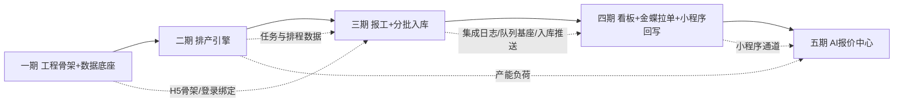

# 虹越智造平台 · 分期任务分解（v1.0）

> ⚠️ **范围重要变更（2026-08-26）**：本平台**不包含发货管理**。发货单、分批发货、库存防超发、小程序发货回写、看板发货区等需求**已全部移出范围**；订单生命周期终止于「已入库（produced）」。原五期「发货收口」子项作废，五期仅保留 AI 报价中心。

> 原则：**每期验收通过后再进入下一期**；一期控制在小而可用；每期交付可独立测试、可独立演示。
> 依赖关系：P1 → P2 → P3 → P4 → P5 顺序推进；P2/P3 可并行开发（排产与报工不互相阻塞），P4 依赖 P3 的推送框架，P5 依赖 P2 的排产数据与 P4 的集成通道。

| 期 | 名称 | 一句话目标 | 主文件数 |
|----|------|-----------|---------|
| 一期 | 工程骨架 + 数据底座 | 跑通登录/RBAC + 机台/班组/产品/BOM/工艺/模具档案 CRUD，本地闭环 | ~55 |
| 二期 | 排产引擎 | 订单中心 + 手工甘特拖拽排产 + 插单顺延 + OR-Tools 智能辅助 + 版本回滚 | ~45 |
| 三期 | 报工 + 分批入库 | 移动端极简报工（扫码/代报/冲减）+ 分批入库 + 金蝶入库单推送 | ~30 |
| 四期 | 看板 + 金蝶拉单 + 小程序回写 | 红灯看板 + 生产订单轮询拉取 + BOM 发布/物料同步 + 进度回写 | ~30 |
| 五期 | AI 报价中心 | 报价参数 + 规则引擎/LLM 估价 + 报价单管理 + 交期联动产能 | ~35 |

---

## 一期：工程骨架 + 数据底座（PLM）

**目标**：交付一个"小而可用"的可运行系统——登录认证（企微 OAuth + 微信扫码绑工号 + 账号密码回退）、RBAC 权限、车间/班组/机台/班制、产品档案、BOM（版本管理，本地，不推金蝶）、工艺路线（工序模板/复制/批量导入）、模具台账（寿命/保养/三匹配基础）。**不含**：排产、报工、集成。

**涉及文件（主要）**
```
# 后端（Laravel 12）
hongyue/{composer.json, .env.example, artisan, docker/php-fpm/Dockerfile, docker/nginx/*, docker-compose.yml}
hongyue/app/Providers/RouteServiceProvider.php          # Modules 路由自动注册
hongyue/app/Modules/Auth/{routes.php, Controllers/AuthController.php, Services/WecomAuthService.php, Services/WxAuthService.php}
hongyue/app/Modules/System/{routes.php, Controllers/{UserController,RoleController,ConfigController,AuditController}.php, Services/ConfigService.php}
hongyue/app/Modules/Plm/{routes.php, Controllers/{MachineController,TeamController,ProductController,BomController,RouteController,MoldController}.php,
                        Services/{ProductService,BomService,RouteService,MoldService,CapacityCalcService}.php,
                        Requests/*.php, Resources/*.php}
hongyue/app/Http/Middleware/{AuthenticateApi.php, CheckPermission.php, AuditLog.php}
hongyue/database/migrations/（organize/users/teams/machines/system_configs/plm 全部表）
hongyue/database/seeders/{RoleSeeder, AdminSeeder, WorkshopSeeder, ShiftConfigSeeder}.php
hongyue/routes/{api.php, mobile.php}
hongyue/tests/Feature/（Auth/CRUD 冒烟测试）
```
```
# 前端 PC（Vite + Vue3 + Element Plus）
frontend/{package.json, vite.config.ts, tsconfig.json, index.html}
frontend/src/{main.ts, App.vue, api/axios.ts, router/index.ts, stores/{auth,user}.ts, layouts/MainLayout.vue}
frontend/src/views/system/{LoginView, UsersView, RolesView, ConfigsView}.vue
frontend/src/views/plm/{MachinesView, TeamsView, ProductsView, ProductsDetailView, BomsView, RoutesView, MoldsView}.vue
frontend/src/components/common/{StatusTag, FormDialog}.vue
```
```
# 移动端 H5 骨架
mobile/{package.json, vite.config.ts, src/main.ts, src/api/axios.ts}
mobile/src/views/login/{WxLoginView, BindEmployeeView}.vue
mobile/src/views/tasks/TodayTasksView.vue        # 占位（二期填充）
```

**实现顺序**
1. 工程骨架：Composer 初始化、Docker Compose（nginx+php-fpm+mysql+redis）、Laravel 安装、Sanctum、spatie/permission、Migrations（组织/系统表）、Seeder
2. 认证与权限：企微 OAuth（扫码→userid→Token）、微信扫码（openid→绑工号）、账号密码回退、RBAC 中间件
3. 基础档案 CRUD：机台 → 班组 → 班制配置（排产计算依赖三位一体）
4. PLM 核心：产品档案 → BOM（版本/状态）→ 工艺路线（工序模板 + 复制 + 产能预览换算）→ 模具台账（寿命字段 + 产品/机台关联）
5. 前端骨架与页面：登录/布局/菜单权限 → 各档案页面
6. 测试与验收：冒烟 + 演示脚本

**依赖**：无（项目首期）；前置输入 = 金蝶物料清单 Excel（产品编码对齐用）、机台清单、模具台账初版（可由客户提供，无则手工录入）

**验收标准（可测试清单）**
| # | 验收项 | 测试方式 |
|---|--------|---------|
| A1 | 部署：`docker compose up` 后浏览器打开登录页，健康检查通过 | 环境检查 |
| A2 | 企微扫码登录成功；无企微账号时账号密码登录回退可用 | 手工 |
| A3 | 微信扫码首次绑工号 → 二次扫码免密直登 | 手工 |
| A4 | 管理员建 3 个角色（工程/计划员/班组长），角色菜单与接口权限生效（越权访问 403） | 手工 + 接口 |
| A5 | 机台 CRUD：新增注塑机 I-01（产能/换模/班制）→ 列表可查 → 编辑 → 停用 | 手工 |
| A6 | 班组 CRUD：注塑一班（班组长/2班制/机台线）、喷漆组（人工线） | 手工 |
| A7 | 产品档案：新建产品（编码=金蝶物料编码）→ 状态流转 开发→试产→量产 有记录 | 手工 |
| A8 | BOM：建 2 个版本，v1 草稿 → v2 发布；未发布版本不可被引用（接口校验） | 接口 |
| A9 | 工艺路线：4 工序（成型→喷漆→效果→包装）配产能参数；**输入 1000 件即时显示 "需 X 小时"**；类似产品复制成功 | 手工 |
| A10 | 模具台账：建注塑模（模穴数 4/寿命 50 万次/造价）→ 关联产品与适用机台 I-01~I-04 → 保养计划录入，到期提醒出现 | 手工 |
| A11 | 操作审计：BOM 发布、模具修改写入 audit_logs | 接口 |
| A12 | 接口自动化冒烟：`php artisan test` 全绿 | 自动化 |

**预估范围**：后端 ~28 文件 / 前端 ~20 文件 / 移动骨架 ~5 文件 / 迁移+种子 ~12 文件；开发 ≈ 2.5~3 周（3 人）

**第三方依赖**
```
composer: laravel/framework@^12, laravel/sanctum, spatie/laravel-permission, predis/predis,
          guzzlehttp/guzzle, maatwebsite/excel（期初导入）, symfony/uid
npm:      vue@^3.4, vue-router@^4, pinia@^2, element-plus@^2.7, axios, dayjs, qrcode, sass
```

---

## 二期：排产引擎（手工甘特 + 插单 + 智能辅助）

**目标**：订单中心（手工建单 + Excel 导入，金蝶拉单四期接入）+ 甘特图排产全交互——任务池拖拽、自动算结束时间（产能+班制+换模）、冲突/超期标红、插单自动顺延+受影响清单+一键确认/回滚、OR-Tools 约束算法一键推荐（异步轮询）、整版接受/局部采纳/版本回滚、保存即锁定。Python 排产服务本期内交付。

**涉及文件（主要）**
```
# 后端
hongyue/app/Modules/Order/{routes.php, Controllers/OrderController.php, Services/OrderService.php, Services/ExcelImportService.php}
hongyue/app/Modules/Scheduling/{routes.php,
    Controllers/{ScheduleDataController, ScheduleActionController, ScheduleVersionController}.php,
    Services/{GanttDataService, ManualScheduleService, InsertScheduleService, AutoScheduleService（编排→Python）, VersionService, LockService, CapacityCalcService}.php,
    Jobs/ScheduleJobPoller.php}
hongyue/app/Services/AiServiceClient.php              # HTTP 调 Python（提交/轮询）
hongyue/database/migrations/（orders/order_lines/prod_tasks/task_schedules/schedule_versions）
hongyue/tests/Feature/Scheduling/（T1/T2/T3/T8/T9/T10 场景测试）
```
```
# Python AI 服务（本期内交付排产部分）
ai-service/{requirements.txt, Dockerfile, app/main.py, app/api/schedule.py, app/api/health.py}
ai-service/app/models/schedule_models.py
ai-service/app/services/scheduler/{cp_sat_solver.py, loader.py, output.py}
ai-service/app/services/job_store.py                 # Redis job 状态
ai-service/tests/（EDD/换模最小化/插单顺延单测）
```
```
# 前端
frontend/src/views/order/{OrdersView, OrderDetailView, ImportView}.vue
frontend/src/views/schedule/{GanttView, TaskPoolPanel, InsertDialog, AutoScheduleDialog, VersionsView, ScheduleDetailView（甘特+明细双视图）}.vue
frontend/src/components/gantt/{GanttChartWrapper.vue（dhtmlx-gantt 封装）, CapacityBar, ConflictBadge}.vue
frontend/src/utils/{CapacityCalc.ts（结束时间计算/吸附）, ScheduleAdapter.ts（后端数据↔甘特格式）}
```

**实现顺序**
1. 订单中心：手工建单/明细 → Excel 导入模板与解析（产品编码匹配校验）
2. 数据服务：待排任务池、机台/班组时间线数据 API（甘特数据源）
3. 手工排产：甘特封装（拖拽/吸附）→ 后端保存排程（**三匹配校验**：产品-模具-机台）→ 自动计算结束时间 → 冲突/超期标红（可强制排入标记超期）
4. 插单：任务拖入 → 受影响订单顺延预览 → 一键确认/回滚
5. Python 排产服务：CP-SAT 建模（区间变量/NoOverlap/序依赖换模）→ 异步 job → Laravel 编排与轮询 → 前端"自动排"按钮 → 整版接受/局部采纳
6. 版本与锁定：schedule_versions 快照/回滚；保存即锁定（解锁留痕）
7. 甘特 + 明细双视图（任务明细表：机台/班组/起止/状态/偏差）

**依赖**：一期（组织/机台/班组/产品/工艺/模具数据底座）

**验收标准**
| # | 验收项 | 测试方式 |
|---|--------|---------|
| B1 | Excel 导入 10 行订单（3 产品）成功，编码不匹配行明确报错 | 手工 |
| B2 | 任务池拖任务到机台时间轴，**系统按标准产能+2班制+换模时间自动计算结束时间并即时显示**（PRD T8） | 手工 |
| B3 | 拖拽到产能不足/模具不可用位置 → 红框提示；强制排入需显式确认并标记超期 | 手工 |
| B4 | 插单：紧急订单拖入满负荷机台 → 后续任务自动顺延 → 输出受影响订单"延期清单" → 一键确认生效 / 回滚恢复（PRD T2/T9） | 手工 |
| B5 | 同类产品连续下达 → 约束算法尽量连续（换模次数 ≤ 手工排法），**换模时间计入机台占用**（PRD T3） | 接口断言 |
| B6 | 点击"自动排"→ 异步求解（≤30s）→ 建议排程可整版接受或回滚到上一版本（PRD T10） | 手工 |
| B7 | 排程保存即锁定；解锁按钮出现审计记录 | 手工 |
| B8 | 产品-模具-机台三匹配：模具适用机台不含该机台时保存被拒 | 接口 |
| B9 | 甘特 + 明细双视图数据一致（机台/班组/起止/状态） | 手工 |
| B10 | Python 服务单测（求解器）全绿；`php artisan test` 排产场景全绿 | 自动化 |

**预估范围**：后端 ~15 文件 / 前端 ~10 文件 / Python ~10 文件；开发 ≈ 3~3.5 周

**第三方依赖**
```
composer: 无新增（guzzle 已含）
python:   fastapi, uvicorn[standard], ortools, pydantic, redis, httpx, pytest
npm:      dhtmlx-gantt（商业授权确认中，备选国产组件：bamboo-gantt / 自绘 SVG 甘特封装）
```

---

## 三期：报工 + 分批入库 + 金蝶入库推送

**目标**：车间移动端（H5）真实可用——登录免密（企微/微信，接一期）、今日任务视图、扫码/点选 1-2 步报工、班组长代报必选实际作业人、补报、冲减更正、合格/次品口径、防重校验（超 100% 提示）、弱网暂存；报工联动任务状态/模具寿命/看板；分批入库（可入库量=报工完成−已入库）→ 生产入库单 → **金蝶 K3 推送（第一个真实集成接口）**，队列重试+回执+对账。

**涉及文件（主要）**
```
# 后端
hongyue/app/Modules/Production/{routes.php, Controllers/{TaskController,ReportController,MoldLifeController}.php,
    Services/{ReportService(含防重/冲减/代报校验), TaskStatusService, MoldLifeService}.php,
    Events/ReportSaved.php, Listeners/{UpdateTaskProgress, UpdateMoldLife, NotifyRunner}.php}
hongyue/app/Modules/Warehouse/{routes.php, Controllers/StockInController.php,
    Services/{StockInService（可入库量计算）, K3StockInPushService}.php}
hongyue/app/Modules/Integration/Services/{K3Client.php（登录Cookie/通用调用）, K3StockInAdapter.php}
hongyue/app/Modules/Integration/Jobs/{PushStockInJob.php}
hongyue/app/Modules/Integration/{routes.php, Controllers/IntegrationLogController.php}
hongyue/database/migrations/（work_reports/mold_life_logs/stock_ins/integration_logs）
hongyue/tests/Feature/（T4 防重 / T7 金蝶故障降级 / 冲减审计用例）
```
```
# 移动端 H5（本期内完整实现）
mobile/src/views/tasks/{TodayTasksView, TaskDetailView(扫码页), TaskQrView}.vue
mobile/src/views/report/{ReportFormView（完成N件/累计）, LeaderReportView（代报批量/必选作业人）, CorrectionView（冲减）}.vue
mobile/src/stores/taskStore.ts（弱网离线暂存队列 localStorage → 联网补传）
mobile/src/utils/qr.ts
```
```
# 前端 PC（补少量）
frontend/src/views/production/{TaskCenterView, ReportBoardView(车间看板:机台当前任务/完成率)}.vue
frontend/src/views/warehouse/{StockInView（可入库量展示/确认入库/推送状态）}.vue
frontend/src/views/system/IntegrationLogsView.vue
```
```
# 金蝶联调环境：K3Cloud 测试账套沙箱 + 生产入库单表单样例报文
```

**实现顺序**
1. 任务扫码载体：任务二维码生成（H5 路由 `/mobile/tasks/{id}`），任务状态机（待开始→进行中→暂停→已完成，报工驱动）
2. 今日任务视图：按登录人（班组/机台绑定）展示当天任务
3. 报工核心：提交校验（防重/超100%提示）→ 落库 work_reports（sign=1）→ 事件联动（任务进度/模具寿命/看板缓存失效）；冲减（sign=-1 更正，原因必填）；代报必选 worker_id
4. 弱网暂存：离线队列补偿（幂等：前端生成 uuid 防重发）
5. 分批入库：可入库量计算 API → 确认入库（强校验 qty ≤ 完成−已入库）→ 生成入库单
6. 金蝶推送：K3Client（鉴权 Cookie 缓存/通用 Save/ExecuteBillQuery）→ PushStockInJob 队列 → 回执写 k3_bill_no → 失败重试 5 次 + 手动重推；集成日志全留痕
7. 机器人/警示：报工超时未报提醒入口（完整提醒四期企微打通，本期内看板可见即可）

**依赖**：一期（登录绑定/H5 骨架）；二期（任务与排程数据落地，报工依托 prod_tasks/task_schedules）；金蝶测试账套授权

**验收标准**
| # | 验收项 | 测试方式 |
|---|--------|---------|
| C1 | 工人手机登录：微信扫码免密（首次绑工号流程走通） | 手工 |
| C2 | 今日任务视图：注塑一班的组长看到本班组全部任务，含机台/产品/数量/计划时间 | 手工 |
| C3 | 扫码 → 任务详情 → 点"完成 50 件"两步完成报工；任务进度/看板/模具开模次数同步更新 | 手工 |
| C4 | 累计报工超任务量 100% 被拦截并提示（PRD T4） | 手工 |
| C5 | 冲减：误报 100 修正为 60，留冲减记录（含原因），台账无 UPDATE | 数据库检查 |
| C6 | 代报：班组长代报未选实际作业人 → 提交被拒 | 手工 |
| C7 | 弱网断网提交 2 笔 → 联网自动补传成功，无重复 | 手工 |
| C8 | 分批入库：任务完成 800，先入库 300 → 可入库量显示 500 → 再入库 500 → 可入库量 0；超量入库被拒 | 手工 |
| C9 | 入库推送金蝶：送 K3 沙箱成功返回单据号；断网重试后恢复推送成功（PRD T7） | 联调 |
| C10 | 集成日志：每次推送 request/response/status 全留痕；失败可手动重推 | 界面检查 |

**预估范围**：后端 ~16 文件 / H5 ~10 文件 / PC ~4 文件；开发 ≈ 3 周

**第三方依赖**
```
composer: 无新增（队列/重试用 Laravel 原生；二维码用前端 qrcode 生成 URL 即可）
npm:      qrcode（PC 端打印任务码）, vconsole（车间调试）
```

---

## 四期：看板红灯 + 金蝶拉单/BOM发布/物料同步 + 小程序回写

**目标**：管理层看板全面上线——订单进度总览（待排/在产/逾期/完成分区）、任务执行看板、产能负荷热力、**红灯管理**（未排产/未报工/逾期/落后>10% 自动暴露，直达责任人）；金蝶生产订单轮询 10min 拉取（排产真实数据源闭环）；BOM 发布直发金蝶；物料同步；小程序进度回写；企微消息提醒。

**涉及文件（主要）**
```
# 后端
hongyue/app/Modules/Dashboard/{routes.php, Controllers/{OrderOverviewController,TaskBoardController,LoadHeatmapController,RedLightController,ReportController}.php,
    Services/{RedLightService（三源计算+Redis缓存）, LoadService, ReportService（依赖指标体系）.php}
hongyue/app/Modules/Integration/Services/{K3ProdOrderPullAdapter.php, K3BomPushAdapter.php, K3MaterialSyncAdapter.php, MiniProgramClient.php（进度回写）}
hongyue/app/Modules/Integration/Jobs/{PullProdOrderJob（10min）, PushBomJob, SyncMaterialJob, PushProgressJob}
hongyue/app/Modules/Integration/Console/{PullProdOrdersCommand, SyncMaterialsCommand}.php
hongyue/app/Modules/Plm/Services/BomPublishService.php   # 发布→直发金蝶（替换一期本地发布）
hongyue/app/Modules/System/Services/{NotificationService（企微应用消息）}.php
hongyue/database/migrations/（materials 物料表）
hongyue/tests/Feature/（红灯规则/轮询增量/幂等用例）
```
```
# 前端
frontend/src/views/dashboard/{OrderOverviewView, TaskBoardView, LoadHeatmapView, RedLightView（责任人聚合+直达处理）, ReportsView}.vue
frontend/src/components/common/{RedLightCard, HeatmapGrid}.vue
frontend/src/views/system/IntegrationConfigView.vue   # K3 连接配置/手动拉取/对账按钮
```
```
# 小程序（与小程序开发方协作，本平台侧提供接口契约 + 联调）
小程序侧：进度查询页（本平台提供进度 API）
```

**实现顺序**
1. 看板数据服务：订单总览/任务看板/负荷热力（机台×日期）
2. 红灯引擎：未排产 + 未报工（计划开始后无报工）+ 逾期 + 落后>10%（deviation_pct）→ Redis 缓存 → 红灯管理页（责任人/直达入口）→ 企微消息提醒
3. 金蝶拉单：PullProdOrderJob（ExecuteBillQuery 增量游标）→ 转 orders/order_lines → 自动生成待排 prod_tasks；手动拉取按钮；集成日志
4. BOM 发布直发：BomPublishService 发布事件 → PushBomJob（K3 Save）→ 回执
5. 物料同步：SyncMaterialJob 每日 + 手动 → materials 表 upsert（产品编码映射基础）
6. 小程序回写：PushProgressJob（报工/排产/入库事件触发 + 定时兜底）→ 进度/预计完成/延期
7. 报表中心：交期达成率/机台利用率/报工及时率/次品率/模具寿命（一期指标口径，从既有数据聚合）

**依赖**：二期（排产数据/负荷来源）、三期（报工数据/入库推送框架/集成日志与队列基座）、金蝶账套生产模块与 BOM 表单可用

**验收标准**
| # | 验收项 | 测试方式 |
|---|--------|---------|
| D1 | 红灯规则：构造 ①未排产任务 ②计划开始 3 小时无报工任务 ③已逾期任务 ④落后>10% 任务 → 看板全部自动标红并聚合到责任人 | 造数验证 |
| D2 | 订单总览分区正确（待排/在产/逾期/完成），逾期红、临期黄 | 造数验证 |
| D3 | 产能负荷热力：机台×未来 7 天，>85% 预警标色 | 手工 |
| D4 | 金蝶拉单：K3 测试账套下推 2 张生产订单 → 10 分钟内平台出现订单与待排任务；手动拉取立即生效；重复拉取不产生重复订单（幂等） | 联调 |
| D5 | BOM 发布：平台发布 v2 → K3 沙箱 BOM 表单出现对应物料与子项，回执落库 | 联调 |
| D6 | 物料同步：K3 修改 1 个物料名称 → 每日同步后 materials 更新；手动触发立即可查 | 联调 |
| D7 | 小程序进度回写：小程序端看到订单/产品级进度、预计完成与延期标识；断网重试后成功 | 联调 |
| D8 | 企微消息：红灯项/临期任务推送到责任人企微 | 手工 |
| D9 | 集成配置页：K3 连接测试、手动拉单、失败重推、日志查询可用 | 手工 |

**预估范围**：后端 ~20 文件 / 前端 ~8 文件；开发 ≈ 2.5~3 周

**第三方依赖**
```
composer: 无新增
npm:      echarts（负荷热力/报表图表）
```

---

## 五期：AI 报价中心

**目标**：报价中心完整可用——报价参数配置（材料价/工序费率/损耗率/摊销规则，生效日期版本）、AI 快速估价（规格+数量 → 规则引擎成本构成 + DeepSeek 辅助解析/说明/异常价校验 → 建议价+建议交期联动产能负荷）、报价单管理（草稿/已发/成交/未成交，数据沉淀）。

**涉及文件（主要）**
```
# 后端
hongyue/app/Modules/Quote/{routes.php, Controllers/{QuoteController, AiEstimateController, QuoteParamController}.php,
    Services/{QuoteParamService, AiQuoteOrchestrator（编排→Python）, QuoteOrderService（转订单）.php}
hongyue/database/migrations/（quotes/quote_lines/material_prices/process_rates/quote_rules）
hongyue/tests/Feature/（T6 报价确定性/超发拦截用例）
```
```
# Python（本期内交付报价部分）
ai-service/app/api/quote.py
ai-service/app/models/quote_models.py
ai-service/app/services/quote/{rule_engine.py, delivery_estimator.py, llm_client.py（DeepSeek OpenAI兼容SDK）}
ai-service/tests/（成本构成/毛利/交期联动用例）
```
```
# 前端
frontend/src/views/quote/{AiEstimateView（规格录入+参考老品+成本明细展开+调价）, QuotesView, QuoteParamsView（材料价/费率/规则）}.vue
frontend/src/utils/PriceCalc.ts（前端即时预览:建议单价构成）
```

**实现顺序**
1. 报价参数配置：材料价格表/工序费率表（生效日期）/报价规则（损耗率/摊销/毛利下限/异常偏差 30%）+ Excel 初始化导入
2. AI 估价编排：AI 服务规则引擎（材料+加工+摊销+损耗 → 建议价，确定性可解释）→ LLM 辅助（规格结构化/近似品匹配/报价说明/±30% 异常提示）→ 交期估算（当前产能负荷粗算 + 排队缓冲）
3. 报价单管理：生成报价单（成本明细可展开）→ 调价留痕 → 状态流转（已发/成交/未成交）→ 历史沉淀（成交价驱动模型迭代）
4. 联调验收 + 试点支持（1-2 个业务员）

**依赖**：二期（排产负荷数据 → 交期联动）、四期（小程序通信通道/集成基座）；DeepSeek API Key

**验收标准**
| # | 验收项 | 测试方式 |
|---|--------|---------|
| E1 | 参数配置：材料价 3 条生效 → 修改后新估价取新价，历史报价不受影响（生效日期口径） | 手工 |
| E2 | 估价：输入规格+数量（选近似老品）→ 输出成本构成明细+建议价+建议交期，**同参数两次估价结果一致**（PRD T6） | 接口断言 |
| E3 | 异常价校验：构造偏离历史成交 30% 估价 → LLM 提示 + 页面警示 | 手工 |
| E4 | 建议交期与当前产能负荷联动：满负荷阶段估价交期明显长于空闲期 | 手工 |
| E5 | 报价单：调价 → 审计留痕；成交后状态流转可统计成交率 | 手工 |
| E6 | 全链路演练：录单→拉单→排产→报工→入库→看板红灯清零 | 场景验收 |

**预估范围**：后端 ~14 文件 / 前端 ~8 文件 / Python ~6 文件；开发 ≈ 2.5~3 周

**第三方依赖**
```
composer: 无新增
python:   openai>=1.0（DeepSeek OpenAI 兼容，配 base_url）, pydantic-settings
npm:      无新增
```

---

## 每期依赖关系总览



## 关键风险与应对（影响分期）

| 风险 | 影响期 | 应对 |
|------|--------|------|
| 金蝶账套/接口授权延迟 | 三/四期 | 三期用 K3 沙箱联调入库单；拉单/BOM/物料四期接入；若授权严重延迟，四期先上线看板红灯（本地数据），金蝶集成后补（每期验收项相应调整，需与客户书面确认） |
| dhtmlx-gantt 商业授权 | 二期 | 提前确认 License；备选方案：国产组件（bamboo 甘特等）或自绘 SVG 甘特（拖拽+吸附+冲突标红，工作量 +5 天） |
| 班组长/工人执行意愿 | 三/四期 | 红灯看板强暴露 + 企微提醒；试点班组先行 |
| 排产参数不准（产能/换模） | 二期 | 一期验收时要求客户提供机台产能表；试运行期人工+系统并行比对，参数可批量导入 |
| 小程序接口契约未定 | 四/五期 | 本平台 API 先行自测，契约文档随架构交付；联调窗口预留 |
